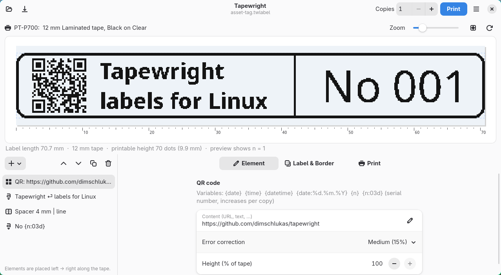

# Tapewright

Tapewright is a label designer for Brother P-touch USB label printers on Linux.
It talks to the printer directly over USB, so it needs no CUPS driver and no Brother software.



> Brother and P-touch are trademarks of Brother Industries, Ltd.
> This is an independent project, not affiliated with or endorsed by Brother.

## Supported printers

| Model | Status |
|---|---|
| PT-P700 | tested |
| PT-P750W, PT-E550W, PT-P710BT (USB), PT-D450, PT-D600 | same raster protocol family; untested, reports welcome |

Supported tapes are TZe tapes 3.5, 6, 9, 12, 18 and 24 mm wide.

## Features

- **Elements:** text, images, QR codes, Code 128 barcodes and spacers.
- **Two layouts:**
  - *Automatic* places elements left to right along the tape.
  - *Free* lets you drag elements anywhere in the preview and resize them with the corner handle.
    Elements snap to the tape centre and edges and to other elements; hold Shift to turn snapping off.
    Arrow keys nudge (Shift = 1 mm), Delete removes, and the right-click menu has front/back and centring.
  - The first drag switches a label to free layout without moving anything.
- **Undo/redo** with Ctrl+Z and Ctrl+Shift+Z.
- **Text:**
  - any installed font and face;
  - auto-size to the tape height, or a fixed point size;
  - multi-line, with line alignment, line and letter spacing, underline and strikethrough.
- **Images:** PNG, JPEG, SVG and more, with dithering or a threshold.
- **Label options:**
  - borders: rectangle, rounded or double;
  - inverted (white-on-black) printing;
  - fixed or automatic length, padding and gaps.
- **Variables:** `{date}`, `{time}`, `{datetime}`, `{date:%d.%m.%Y}`, and the serial number `{n}` / `{n:03d}`, which increases with each copy.
- **Printer integration:**
  - live printer status: tape width, type, colours and errors;
  - follows the inserted cassette automatically;
  - the preview is dot-accurate and drawn in the real tape and ink colours.
- **Printing:** copies, auto cut, chain printing, and feed margin.
- **Files and CLI:** save and load labels (`.twlabel`), export PNG at 180 dpi, and a command-line interface for scripting.

## Installation

### Arch Linux

```sh
cd packaging/arch && makepkg -si
```

### Other distributions

Install the system packages first:

| Distribution | Command |
|---|---|
| Debian / Ubuntu | `sudo apt install python3-gi python3-gi-cairo python3-pil gir1.2-gtk-4.0 gir1.2-adw-1 libusb-1.0-0 python3-qrcode` |
| Fedora | `sudo dnf install python3-gobject python3-cairo python3-pillow gtk4 libadwaita libusb1 python3-qrcode` |

Then install Tapewright and its desktop integration:

```sh
pipx install --system-site-packages .      # or: pip install --user .
sudo make install-data reload-udev          # launcher, icon, udev rule
```

### Run from source without installing

```sh
python3 -m tapewright
```

### Permissions

The udev rule `data/60-tapewright.rules` gives the logged-in user access to the printer.
Install it with `make install-data` and replug the printer.
Without the rule, Tapewright falls back to `/dev/usb/lp0`, which requires membership in group `lp`.

### Editor Lite mode

If the green *Editor Lite* LED is lit, the printer appears as a USB drive instead of a printer.
Hold the Editor Lite button until the LED goes off.

## Command line

```sh
tapewright                                    # GUI
tapewright status
tapewright print -t "Hello\nWorld" -b rounded -c 3
tapewright print examples/asset-tag.twlabel -c 10 -n 1   # serial numbers 1..10
tapewright render -t "Test" --qr https://example.com -o out.png
```

Run `tapewright print --help` for all options.

## Development

```sh
make test            # hardware-free unit tests
```

The code is organised as follows:

| File | Contents |
|---|---|
| `tapewright/usb.py` | libusb (ctypes) and usblp transports |
| `tapewright/protocol.py` | status parsing, PackBits, job builder |
| `tapewright/render.py` | label model and Cairo/Pango renderer |
| `tapewright/barcode.py` | Code 128 encoder |
| `tapewright/gui.py` | GTK 4 / libadwaita editor |
| `tapewright/cli.py` | command line |

[docs/PROTOCOL.md](docs/PROTOCOL.md) describes the printer protocol.

## License

Copyright © 2026 dimschlukas.

Tapewright is free software: you can redistribute it and/or modify it under the terms of the GNU General Public License as published by the Free Software Foundation, either version 3 of the License, or (at your option) any later version.
See [LICENSE](LICENSE).
